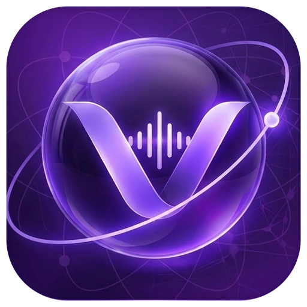
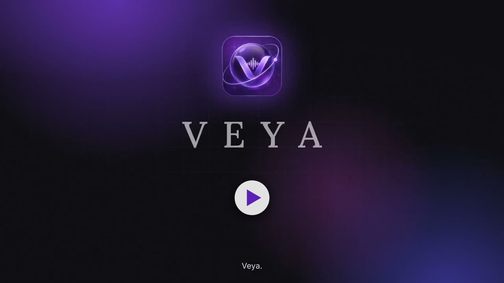

<div align="center">



# Veya

**Think it. Speak it. Build it.**

Talk through a rough idea, and Veya turns it into a project plan you can actually build: a step-by-step blueprint, a README, a workflow diagram and a timeline that fits your deadline.

<a href="docs/veya-demo.mp4">
  
</a>

<sub>▶ Click the image to watch the 2-minute demo.</sub>

</div>

---

## Why we built it

Every hackathon starts the same way. Someone has an idea, opens a chatbot, and an hour later there is a long thread of half-answers about React vs Flutter, which database, what the deadline really is, and the original idea is buried somewhere near the top.

Veya flips that around. Instead of you asking a chatbot questions, **Veya asks you** the few questions that matter, out loud, in your own language. Then it hands you a plan.

## What it does

- **Talk, don't type.** Tap once and have a conversation. Veya asks about your idea, your timeline and the tech you know. The mic opens on its own when Veya finishes speaking and sends your answer when you stop talking.
- **Speaks your language.** Answers can be in English or Indian languages (Hindi, Tamil, Telugu, Kannada, Malayalam, Bengali, Marathi, Gujarati, Punjabi), and Veya replies in the language you pick.
- **Or chat instead.** A separate text chat where Veya decides what to ask next based on what you've said, with no fixed script.
- **A real plan at the end.** Once you confirm the summary, Veya generates:
  - a project blueprint (problem, solution, features, architecture, tech stack, risks, demo readiness)
  - a README you can drop into your repo
  - a workflow diagram
  - a concept image, on request
- **A timeline that fits your deadline.** Say "this weekend" or "15 March" and Veya splits the days into phases that suit the project, like UI, backend, auth and demo prep. Deadlines show up on the calendar.
- **Your ideas in one place.** Save ideas, turn them into projects, track tasks and milestones, and look back at past chats.
- **Make it yours.** Three themes (Violet, Graphite, Emerald), a profile photo or one of ten mascots.

## How it works

```
 Expo app (iOS · Android · Web)
        │  REST
        ▼
 FastAPI backend (gnani/)
        ├── Gnani speech-to-text / text-to-speech   (voice in, voice out)
        ├── Language layer                           (translate to and from English)
        ├── Conversation manager                     (questions, summary, confirmation)
        ├── Perception + Reasoning layers            (local Qwen model via Ollama)
        ├── README + Mermaid diagram generation
        ├── Stable Diffusion                         (concept images, only on request)
        └── SQLite                                   (saved projects)
```

The app never talks to the speech or model services directly. All keys stay on the server.

## Tech stack

| Part | Built with |
|---|---|
| Mobile and web app | Expo SDK 58, React Native, Expo Router, TypeScript, Zustand |
| Sign-in | Clerk (email and Google) |
| Voice | expo-audio, Gnani (Vachana) STT and TTS |
| Backend | FastAPI, Pydantic, SQLite |
| Language model | Qwen 2.5 (7B) running locally through Ollama |
| Diagrams and images | Mermaid, Stable Diffusion (diffusers) |

## Project structure

```
veya/
├── src/
│   ├── app/          screens (file-based routes)
│   ├── components/   UI building blocks
│   ├── stores/       app state (conversation, chat, projects, …)
│   ├── lib/          API client, audio, voice detection, helpers
│   └── theme/        colours, typography, themes
├── assets/           fonts, logo, mascots
├── docs/             demo video
└── gnani/            FastAPI backend
    ├── services/     conversation, chat, language, perception, reasoning, speech, visuals, projects
    ├── tools/        tools the reasoning layer can call
    ├── webapp/       API routes
    └── tests/
```

## Getting started

### What you need

- Node.js 20+ and npm
- Python 3.12 and [uv](https://docs.astral.sh/uv/)
- [ffmpeg](https://ffmpeg.org/) (converts recordings for speech-to-text)
- [Ollama](https://ollama.com/) with the Qwen model: `ollama pull qwen2.5:7b`
- A Gnani (Vachana) API key and a Clerk publishable key

### 1. Configure

Both the app and the backend read one `.env` file in the project root. Start from the example and fill in your keys:

```bash
cp gnani/.env.example .env
```

Then add the app settings to the same file:

```bash
EXPO_PUBLIC_CLERK_PUBLISHABLE_KEY=pk_test_...
EXPO_PUBLIC_VEYA_API_URL=http://localhost:8000
```

`EXPO_PUBLIC_VEYA_API_URL` is where the app finds the backend:

| Running on | Use |
|---|---|
| iOS simulator or web | `http://localhost:8000` |
| Android emulator | `http://10.0.2.2:8000` |
| A phone on the same Wi-Fi | `http://<your computer's IP>:8000` |

Only `EXPO_PUBLIC_*` values end up in the app. Everything else stays on the server.

### 2. Run the backend

```bash
ollama serve
cd gnani
uv sync
uv run uvicorn webapp.app:app --host 0.0.0.0 --port 8000
```

### 3. Run the app

```bash
npm install
npx expo start
```

Scan the QR code with Expo Go, or press `i`, `a` or `w` for the iOS simulator, Android emulator or web.

## Tests

```bash
# backend (no API credits or running model needed; external services are faked)
cd gnani && uv run pytest

# app
npx tsc --noEmit
npx expo lint
```

## What's next

- Verify sign-in on the server so each user's projects are properly private.
- Let people interrupt Veya by talking, instead of waiting for the reply to finish.
- Save conversations in progress, so a server restart doesn't end them.

## License

See [LICENSE](LICENSE).
