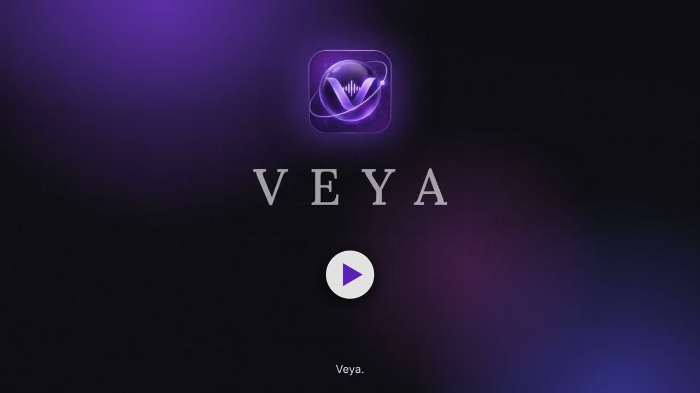

<div align="center">


# Veya

**Think it. Speak it. Build it.**

Your idea companion. Talk through your ideas, pick the one worth building, and get a plan you can start on today.

<a href="https://drive.google.com/file/d/1nNryG1SvNe19qxy6zwutwOx92dzWi12L/view">
  
</a>

<sub>▶ Click the image to watch the 2-minute demo · <a href="https://drive.google.com/file/d/1nNryG1SvNe19qxy6zwutwOx92dzWi12L/view">Open on Google Drive</a></sub>

</div>

---

## The problem

Students spend too long ideating. They go back and forth with ChatGPT or Claude, burn through tokens, and end up buried in long, unfocused answers before they've built anything. And they still don't know if their idea has already been done, or whether it fits the hackathon they're entering.

## How Veya fixes it

**1. Ideate one idea at a time.** Talk to Veya about an idea. It asks only the questions that matter, then turns it into a full project: plan, README, workflow diagram and timeline. Then talk about the next one. When you're done ideating, all your projects are ready and waiting.

**2. Analyze them for your event.** Hackathon, college project or anything else: just say its name or paste a link. Veya looks up the event, finds its judging criteria and scores each of your ideas against them, so you see which one is worth building.

**3. See what already exists.** Veya searches GitHub and Devpost for real projects like yours, with links. A general chatbot won't show you that.

**4. Make yours better than theirs.** Veya suggests how to stand out from those projects and fit the criteria better. One tap applies the changes to your whole project, workflow and README, ready to build from directly.

**5. Build on time.** Every project's deadline is split into phases and daily tasks on your timeline, so you stay on track.

**No idea yet? No problem.** Tell Veya what you're into, your skills and your time. It researches real problems and gives you the most novel ideas you can actually build, with sources. No need to keep asking other AIs for a good idea.

**Talk in your language.** English, Hindi, Tamil, Telugu, Kannada, Malayalam, Bengali, Marathi, Gujarati or Punjabi, by voice or text.

Veya makes the ideation stage faster, easier and structured.

**This is Veya, your idea companion. Let's start building.**

## How it works

```
 Expo app (iOS · Android · Web)
        │  REST + Clerk sign-in
        ▼
 FastAPI backend (gnani/)
        ├── Gnani speech-to-text / text-to-speech
        ├── Language layer          (translate to and from English)
        ├── Conversation manager    (questions, summary, confirmation)
        ├── Language model          (Qwen via Ollama, Gemini or Groq)
        ├── Idea Check + Analyze    (GitHub, Devpost and hackathon-site search)
        ├── Plans, diagrams, images (README, Mermaid, Stable Diffusion)
        ├── Idea engine             (Innovator)
        └── SQLite                  (projects and conversations)
```

All keys stay on the server; the app only talks to the backend.

## Tech stack

| Part | Built with |
|---|---|
| App | Expo, React Native, Expo Router, TypeScript, Zustand |
| Sign-in | Clerk (email and Google) |
| Voice | expo-audio, Gnani (Vachana) STT and TTS |
| Backend | FastAPI, Pydantic, SQLite |
| Models | Qwen 2.5 7B (Ollama), Google Gemini, Groq |
| Visuals | Mermaid, Stable Diffusion |

## Project structure

```
veya/
├── src/               the app (screens, components, state, API client)
├── assets/            fonts, logo, mascots
├── veya-idea-engine/  Innovator's research engine
└── gnani/             FastAPI backend (services, routes, tests)
```

## Getting started

### What you need

- Node.js 20+ and npm
- Python 3.12 and [uv](https://docs.astral.sh/uv/)
- [ffmpeg](https://ffmpeg.org/) (converts recordings for speech-to-text)
- [Ollama](https://ollama.com/) with the Qwen model: `ollama pull qwen2.5:7b`
- A Gnani (Vachana) API key and a Clerk publishable key
- Optional: a Gemini and/or Groq API key to use cloud models

### 1. Configure

Both the app and the backend read one `.env` file in the project root. Start from the example and fill in your keys:

```bash
cp gnani/.env.example .env
```

Then add the app settings to the same file:

```bash
EXPO_PUBLIC_CLERK_PUBLISHABLE_KEY=pk_test_...
EXPO_PUBLIC_VEYA_API_URL=http://localhost:8000
```

`EXPO_PUBLIC_VEYA_API_URL` is where the app finds the backend:

| Running on | Use |
|---|---|
| iOS simulator or web | `http://localhost:8000` |
| Android emulator | `http://10.0.2.2:8000` |
| A phone on the same Wi-Fi | `http://<your computer's IP>:8000` |

For cloud models, also add `GEMINI_API_KEY` and/or `GROQ_API_KEY`. Only `EXPO_PUBLIC_*` values end up in the app.

### 2. Run the backend

```bash
ollama serve
cd gnani
uv sync
uv run uvicorn webapp.app:app --host 0.0.0.0 --port 8000
```

The Innovator engine starts with the backend. Its settings are in `veya-idea-engine/.env` (see its [README](veya-idea-engine/README.md)).

### 3. Run the app

```bash
npm install
npx expo start
```

Scan the QR code with Expo Go, or press `i`, `a` or `w` for the iOS simulator, Android emulator or web.

## Tests

```bash
# backend (no API credits or running model needed; external services are faked)
cd gnani && uv run pytest

# app
npx tsc --noEmit
npx expo lint
```

## License

See [LICENSE](LICENSE).
